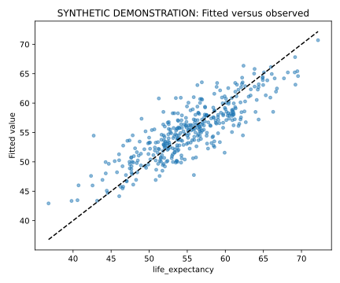

# Results walkthrough

All values below are synthetic or illustrative workflow results.

| Model | Observations | Adjusted R² | AIC | BIC |
| --- | --- | --- | --- | --- |
| model_012 | 388 | 0.711729 | 1973.22 | 1993.03 |
| model_011 | 388 | 0.711701 | 1973.26 | 1993.07 |
| model_005 | 388 | 0.711669 | 1972.32 | 1988.16 |
| model_013 | 388 | 0.668986 | 2026.87 | 2046.67 |
| model_006 | 388 | 0.66888 | 2026 | 2041.85 |

The synthetic input has 400 rows; 388 remain in the common sample. Fifteen specifications are estimated. The displayed ordering is exploratory and does not certify causal or predictive validity.

The numerical files in [demo_output](../demo_output/) are the authoritative bundled artifacts. Re-run the entry command to reproduce the workflow. Figure metadata can differ across renders even when the underlying numerical example is unchanged.
